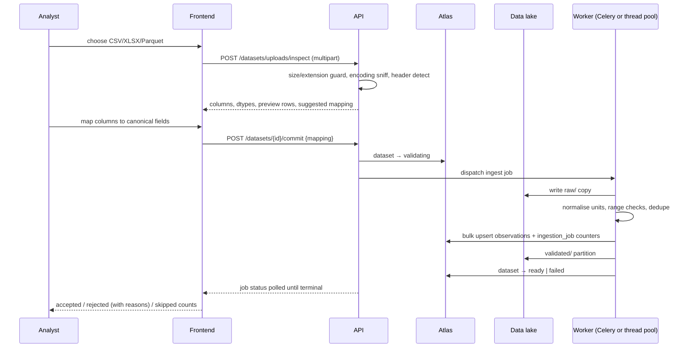
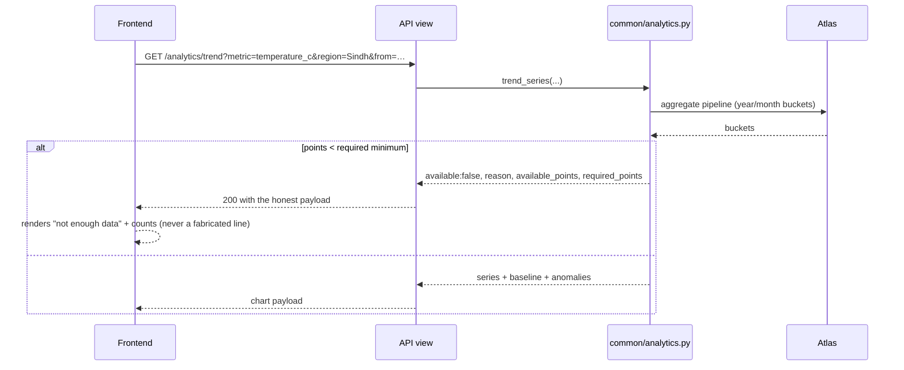
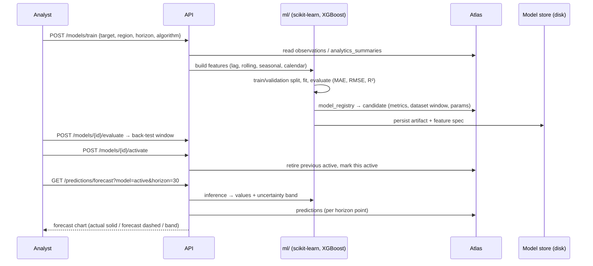
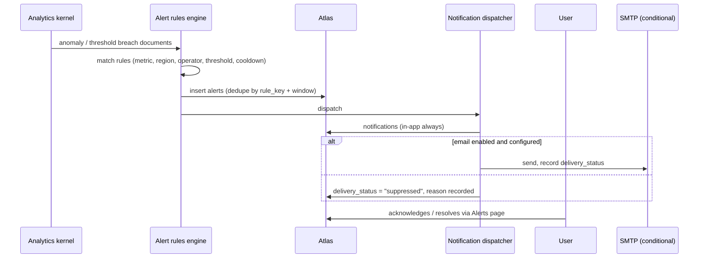

# Design diagrams

Every diagram below is traceable to code in this repository. Where a component
is optional (Kafka, Airflow, a real Hadoop cluster), the diagram marks it as
*conditional* rather than drawing it as always-present — the platform behaves
the same way and says which engines are actually configured.

Legend: `([...])` process · `{...}` data store · `[...]` external entity ·
`==>` data flow.

---

## 1. Context diagram (DFD Level 0)

```mermaid
flowchart LR
    AN[Climate analyst]
    AD[Platform administrator]
    VI[Viewer / stakeholder]

    subgraph PLAT["EarthScape Climate Agency Platform"]
        P1(([Climate intelligence platform]))
    end

    EXT1[(NASA POWER)]
    EXT2[(NOAA CDO)]
    EXT3[(Open-Meteo live)]
    ATLAS[(MongoDB Atlas)]
    LAKE[(HDFS / data lake)]
    SMTP[SMTP gateway]

    AN -->|queries, uploads, trains models, acknowledges alerts| P1
    VI -->|views dashboards, exports, feedback| P1
    AD -->|manages users, rules, pipelines, settings, audit| P1
    P1 -->|dashboards, maps, forecasts, alerts, reports| AN
    P1 -->|PDF / CSV reports| AD

    EXT1 -->|daily point observations| P1
    EXT2 -.->|dataset station search + data| P1
    EXT3 -->|current conditions| P1
    P1 -->|documents: users, observations, jobs, models, alerts| ATLAS
    ATLAS -->|query results| P1
    P1 -->|raw / validated / processed / analytics / ml-features| LAKE
    LAKE -->|Parquet aggregates, feature tables| P1
    P1 -.->|alert + report email, only when SMTP configured| SMTP
```

Readers, not the browser, ever reach Atlas: the React app speaks only HTTPS
JSON to the Django API, which owns the database connection.

---

## 2. Level 1 DFD — six core processes

```mermaid
flowchart TB
    U[Users: viewer / analyst / admin]
    SRC[(External providers + uploaded files)]
    DB[(MongoDB Atlas)]
    LAKE[(Data lake: HDFS or local)]

    C1(([1. Authenticate & authorise]))
    C2(([2. Ingest & validate climate data]))
    C3(([3. Process in batch and stream]))
    C4(([4. Analyse & visualise]))
    C5(([5. Predict: ML models & forecasts]))
    C6(([6. Alert, notify, report, support]))

    U -->|credentials, session| C1
    C1 -->|JWT access/refresh, role, capabilities| U
    C1 -->|users, refresh_tokens, audit_logs| DB

    SRC -->|API payloads, CSV/JSON/XLSX/Parquet| C2
    C1 -->|ingest permission| C2
    C2 -->|validated observation docs, ingestion_jobs| DB
    C2 -->|raw/, validated/ partitions| LAKE

    C1 -->|run workflow permission| C3
    LAKE -->|partitioned inputs| C3
    C3 -->|processed/, analytics/, ml-features/| LAKE
    C3 -->|processing_jobs, analytics_summaries| DB

    DB -->|observations, summaries| C4
    C1 -->|read permission| C4
    C4 -->|series, comparisons, heatmaps, map points, coverage| U

    C1 -->|train / forecast permission| C5
    DB -->|features, history| C5
    LAKE -->|feature tables| C5
    C5 -->|model_registry, predictions| DB
    C5 -->|metrics, forecast charts| U

    DB -->|thresholds, anomalies, forecasts| C6
    C6 -->|alerts, notifications, reports, tickets, feedback| DB
    C6 -->|in-app + optional email| U
```

---

## 3. Level 2 DFD — process 2 (ingestion and validation)

```mermaid
flowchart LR
    A[(Provider / file)] --> B21(([2.1 Discover & fetch]))
    subgraph B21p["connectors"]
        B21 --> B22(([2.2 Normalise to canonical schema]))
    end
    B22 --> B23(([2.3 Validate units & ranges]))
    B23 -->|rejects with reasons| REJ[(rejection sample list)]
    B23 --> B24(([2.4 Dedupe]))
    B24 --> B25(([2.5 Write documents]))
    B25 --> OB[(climate_observations)]
    B25 --> JJ[(ingestion_jobs)]
    B24 --> RAW[[raw/ + validated/ in the lake]]
    JJ --> SCH(([2.6 Scheduler / Celery or thread pool]))
    SCH --> B21
```

Key data element: `dedupe_key = dataset_id|location_code|observation_date`,
covered by a unique index, so re-running a job is idempotent — a second import
counts as `records_skipped`, never as duplicate measurements.

---

## 4. Level 2 DFD — process 3 (Hadoop / Spark processing)

```mermaid
flowchart TB
    OB[(climate_observations)] --> EXP(([3.0 Export to lake]))
    EXP --> RAW[[raw/dataset=…/date=…]]
    RAW --> MR(([3.1 MapReduce: streaming mapper/reducer]))
    RAW --> SP(([3.2 PySpark: aggregation, seasonality, features]))
    MR --> PROC[[processed/]]
    SP --> PROC
    PROC --> AGG(([3.3 Analytics rollups]))
    AGG --> AN[[analytics/]]
    AN --> SUM[(analytics_summaries)]
    AGG --> FEAT(([3.4 Feature assembly]))
    FEAT --> MF[[ml-features/]]
    STREAM[[Kafka climate.observations.v1 - conditional]] -.-> SP
```

Two interchangeable implementations of the same job are kept deliberately: the
MapReduce streaming job proves the Hadoop path, and PySpark proves the
columnar/Parquet path. When no cluster is configured, Spark runs `local[*]` and
the lake stays on local disk; the processing monitor reports the engine it
actually used per job.

---

## 5. Sequence — sign in, session, and expiry

```mermaid
sequenceDiagram
    participant B as Browser (React)
    participant A as Django API
    participant D as MongoDB Atlas

    B->>A: POST /auth/login {email, password}
    A->>D: find user by email_normalized
    D-->>A: user doc (bcrypt hash, role, lock state)
    A->>A: bcrypt verify · failed-count / lockout check
    alt too many failures
        A-->>B: 423 locked (15-minute window)
    else credentials valid
        A->>D: insert refresh_tokens (hash only, family id)
        A-->>B: {access (20 min, memory), refresh (7 days, localStorage)}
    end
    B->>A: GET /climate/observations  Authorization: Bearer …
    A->>D: verify signature, check token not revoked, read role
    A-->>B: 200 page of observations
    Note over B: access token expired
    B->>A: 401 → POST /auth/refresh {refresh}
    A->>D: rotate: revoke old, insert new (same family)
    alt reuse detected
        A->>D: revoke the whole family
        A-->>B: 401 → forced sign-out
    else ok
        A-->>B: new pair; original request retried once
    end
```

---

## 6. Sequence — file upload to queryable data



Rejected rows are reported as counts plus a sample of reasons — the count is
real, and no rejected value is silently dropped into the dataset.

---

## 7. Sequence — analytics query with the insufficient-data guard



The same kernel backs the API, the ML features and the MapReduce/Spark rollups,
so a trend on the dashboard and a trend in a report cannot disagree.

---

## 8. Sequence — train, evaluate, activate, forecast



Models are retrained on demand or by the scheduled job; a model can only become
active if it has real evaluation metrics computed from stored observations.

---

## 9. Sequence — anomaly to alert to notification



Alerts never auto-delete; acknowledgement, resolution and the actor are audit
recorded.

---

## 10. Report generation

```mermaid
flowchart LR
    REQ[Analyst request: type, period, region, format] --> Q(([Resolve scope]))
    Q --> AG[(analytics_summaries / observations)]
    AG --> BUILD(([Build sections: KPIs, trends, anomalies, forecasts]))
    BUILD --> PDF[reportlab PDF]
    BUILD --> CSV[CSV export stream]
    PDF --> ST[(reports doc + file on disk)]
    CSV --> ST
    ST --> DL[Authorised download by request id]
```

Instant exports stream directly from the query; queued reports run as jobs and
record real row counts, page counts and the period actually covered.

---

## 11. Physical deployment topology

```mermaid
flowchart TB
    subgraph Client
        BR[Browser: React SPA]
    end
    subgraph Edge["nginx (container or host)"]
        NG[static SPA + /api proxy + security headers]
    end
    subgraph App["Application tier"]
        G[uWSGI-less Gunicorn x3 workers]
        DJ[Django 5 + DRF]
        CEL[Celery worker + beat]
        TP[in-process pool fallback]
    end
    subgraph Data["Document tier"]
        AT[(MongoDB Atlas: earthscape_climate)]
    end
    subgraph Lake["Processing tier (conditional)"]
        NN[HDFS NameNode :8020 / UI :9870]
        DN[DataNode(s)]
        SM[Spark master :7077 / UI :8085]
        SW[Spark worker]
        MR[Hadoop MapReduce Streaming]
    end
    subgraph Aux
        RD[(Redis: broker/results)]
        KA[[Kafka topic climate.observations.v1]]
        AF[Airflow scheduler + DAG]
        EM[SMTP relay]
    end

    BR -->|HTTPS 443/8080| NG
    NG --> G --> DJ --> AT
    DJ --> CEL --> RD
    DJ --> TP
    CEL --> AT
    DJ -->|webhdfs / local FS| NN
    NN --- DN
    DJ -->|spark-submit| SM --- SW
    SM --> MR
    DJ -.-> KA
    AF -->|REST /api/v1 only| NG
    CEL -.-> EM
    BK[backup.sh → mongodump + SHA256] --> AT
```

Scaling notes: the API tier is stateless — access tokens are self-contained and
sessions live in Atlas, so Gunicorn instances can be added behind nginx
(`upstream` block) without sticky sessions. Celery workers scale independently
for ingest/processing/report load. Spark and Hadoop scale horizontally by
adding DataNodes/Executors; MongoDB Atlas scales by upgrading the cluster tier.
Partitioning (`region_code/year/month` denormalised onto each observation) plus
the compound indexes keep reads bounded as volume grows.

---

## 12. Data lifecycle through the lake

```
MongoDB Atlas (system of record)
   │  export
   ▼
raw/<dataset>/<yyyy>/<mm>/<dd>/part-*          immutable source snapshot
   │  validate + normalise (unit, range, dedupe)
   ▼
validated/<region_code>/year=<y>/month=<m>/*.parquet
   │  MapReduce + Spark aggregation, anomaly scoring
   ▼
processed/…                                    per-station daily, cleaned
   ▼
analytics/…                                    trend, compare, seasonality, coverage
   ▼
ml-features/…                                  lag/rolling/seasonal feature tables
   ▼
exports/…                                      CSV/Parquet handed to users
```

Every stage records the job id, engine used, input row count and output row
count, so a number on screen can be traced back to the documents that produced
it.
